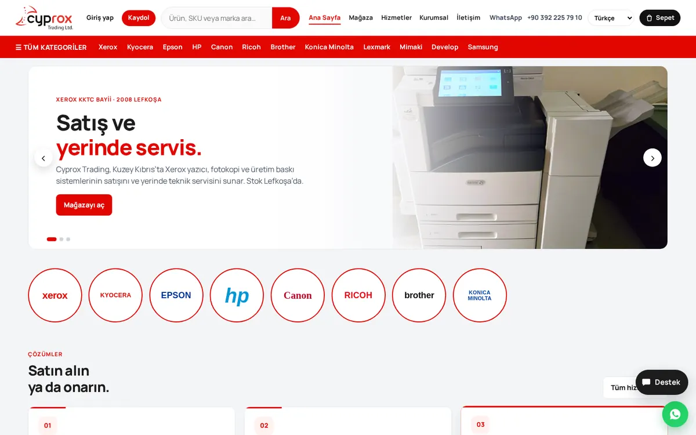

# Cyprox Trading Store

**Xerox dealer · e-commerce & corporate site**

> **Source code is private — this repository is a showcase.** It contains only this README and screenshots; no source code, credentials or customer data.

🔗 **Live:** [cyprox.com.tr](https://cyprox.com.tr)

## What it is
The corporate website and online store for Cyprox Trading, an authorised Xerox dealer in Lefkoşa (Nicosia), North Cyprus — selling printers, toner and spare parts and offering on-site technical service.

## Key features
- Product catalogue for printers, toner and parts, with brand and category navigation
- Search by product, SKU or brand
- Cart, checkout and customer accounts
- Six-language interface
- Live exchange rates for pricing
- Support chat and WhatsApp contact
- Admin panel for products and orders
- Product & order synchronisation with the BizimHesap ERP
- SEO-focused structure

## Tech stack
- Node.js · JavaScript
- BizimHesap ERP API integration
- i18n (6 languages)
- SEO (structured data, sitemaps)

## Architecture overview
```
Storefront (multilingual) ──► Node.js backend ──► Database
                                   │
                                   └──► BizimHesap ERP (products, stock, orders sync)
```
- ERP credentials and sync run server-side only; the storefront never talks to the ERP directly.

## Screenshots

*Homepage (cyprox.com.tr)*

## Contact
**Göksel Eren Nurcan** — full-stack & mobile developer
🌐 [gokselerennurcan.dev](https://gokselerennurcan.dev) · ✉️ gerennurcan02@gmail.com · GitHub [@KhaiRonin](https://github.com/KhaiRonin)

Happy to give a walkthrough or a live demo on request.
